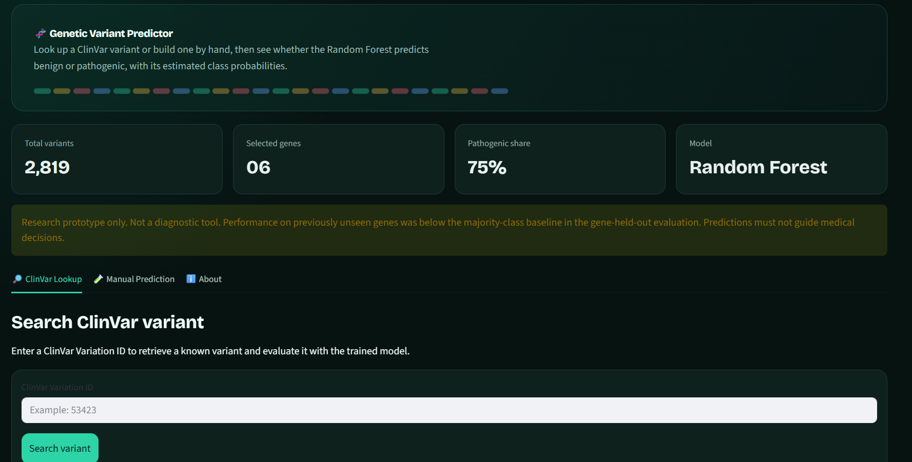
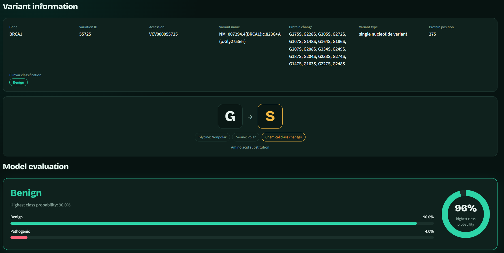

# Multi-Gene Genetic Variant Pathogenicity Prediction

An interpretable machine-learning project for classifying missense genetic variants as **Pathogenic** or **Benign** using data from NCBI ClinVar.

## Overview

This project explores machine-learning-based pathogenicity prediction across six clinically relevant genes.

It uses variant information from the NCBI ClinVar database, extracts biological and molecular features, and trains a Random Forest classifier to distinguish pathogenic from benign variants.

The project also includes an interactive Streamlit application for looking up known ClinVar variants and generating predictions from manually entered variant features.

**Research purpose:** Explore the potential and limitations of machine learning for genetic variant classification. This is an academic research prototype, not a clinical diagnostic system.

## Genes Included

| Gene | Associated condition |
|---|---|
| CFTR | Cystic fibrosis |
| BRCA1 | Hereditary breast and ovarian cancer susceptibility |
| TP53 | Li-Fraumeni syndrome |
| HBB | Sickle cell disease and beta-thalassemia |
| LDLR | Familial hypercholesterolemia |
| PAH | Phenylketonuria |

## Dataset

**Source:** [NCBI ClinVar](https://www.ncbi.nlm.nih.gov/clinvar/)

The dataset was collected using the following ClinVar search query:

```text
((CFTR[gene] OR BRCA1[gene] OR TP53[gene] OR HBB[gene] OR LDLR[gene] OR PAH[gene]) AND missense_variant[molcons])
```

### Dataset preparation

| Processing stage | Records |
|---|---:|
| Initial ClinVar records | 13,992 |
| Excluded: unsupported or missing classifications | 11,080 |
| Excluded: unparseable protein substitutions | 93 |
| Final processed dataset | **2,819** |

### Final class distribution

| Class | Records |
|---|---:|
| Pathogenic | 2,107 |
| Benign | 712 |

### Target labels

| ClinVar classification | Model label |
|---|---:|
| Pathogenic | 1 |
| Likely pathogenic | 1 |
| Pathogenic/Likely pathogenic | 1 |
| Benign | 0 |
| Likely benign | 0 |
| Benign/Likely benign | 0 |

Uncertain, conflicting, and unsupported classifications were excluded from binary classification.

## Features

The model uses six input features:

| Feature | Description |
|---|---|
| Gene | Gene associated with the variant |
| Variant type | Type of genetic variation |
| Molecular consequence | Functional consequence of the variant |
| Protein position | Position of the amino acid substitution |
| Original amino acid | Amino acid before substitution |
| New amino acid | Amino acid after substitution |

ClinVar classifications and identifiers are not used as predictive features. Condition information is also excluded to avoid target leakage.

## Machine-Learning Methodology

The project uses a preprocessing and classification pipeline:

1. Load the raw ClinVar dataset.
2. Filter records to supported binary classifications.
3. Select the six target genes.
4. Parse amino acid substitutions and protein positions.
5. Encode categorical features.
6. Scale the numerical protein-position feature.
7. Train a Random Forest classifier.
8. Evaluate the model using a held-out test set and additional validation experiments.

### Model Configuration

| Parameter | Configuration |
|---|---|
| Algorithm | Random Forest Classifier |
| Number of trees | 300 |
| Class weighting | Balanced |
| Random state | 42 |
| Categorical preprocessing | One-hot encoding |
| Numerical preprocessing | Standard scaling |

## Results

### Held-out Test-set Performance

| Metric | Result |
|---|---:|
| Accuracy | 92.02% |
| Precision | 92.74% |
| Recall | 96.92% |
| F1-score | 94.79% |
| Balanced accuracy | 87.19% |

### Confusion Matrix

Class order: `[Benign, Pathogenic]`

| | Predicted benign | Predicted pathogenic |
|---|---:|---:|
| Actual benign | 110 | 32 |
| Actual pathogenic | 13 | 409 |

### Additional Evaluation

| Evaluation | Result |
|---|---:|
| Protein-grouped cross-validation accuracy | 91.35% ± 1.39% |
| Gene-held-out accuracy | 70.2% |
| Gene-held-out majority-class baseline | 77.5% |

Protein-grouped cross-validation evaluates the model while keeping variants sharing the same protein change together within a fold.

Gene-held-out evaluation tests generalization to genes excluded entirely from training. The aggregate accuracy of 70.2% is below the 77.5% majority-class baseline. Results also vary considerably across individual genes.

These findings indicate that strong performance on the held-out test set does not establish reliable generalization to previously unseen genes.

## Streamlit Application

The project includes an interactive application with three main sections:

### 1. ClinVar Lookup

Search for a variant using its ClinVar Variation ID and view its available information, model prediction, predicted class probabilities, and comparison with the ClinVar classification.

### 2. Manual Prediction

Enter gene, variant type, molecular consequence, protein position, and amino acid substitution to obtain a model prediction.

### 3. About

Explore project information, selected genes, model features, evaluation results, and limitations.

## Project Structure

```text
Genetic-Variant-Pathogenicity/
│
├── app.py
├── run_pipeline.py
├── requirements.txt
├── README.md
│
├── data/
│   ├── raw/
│   ├── processed/
│   └── external/
│
├── docs/
│   └── REFACTORING_GUIDE.md
│
├── models/
│   └── random_forest_clinvar.pkl
│
├── notebooks/
│   └── Genetic_variant_pathogenicity.ipynb
│
├── results/
│   ├── test_metrics.json
│   ├── confusion_matrix.csv
│   └── additional validation results
│
└── src/
    ├── __init__.py
    ├── config.py
    ├── data_preprocessing.py
    ├── model.py
    ├── train.py
    └── evaluate.py
```

## Installation and Usage

### 1. Clone the Repository

```bash
git clone <YOUR_GITHUB_REPOSITORY_URL>
cd Genetic-Variant-Pathogenicity
```

### 2. Create a Virtual Environment

```bash
python -m venv venv
```

Activate on Windows:

```powershell
venv\Scripts\activate
```

### 3. Install Dependencies

```bash
pip install -r requirements.txt
```

### 4. Run the Complete ML Pipeline

Place the original ClinVar TSV dataset inside `data/raw/`, then execute:

```bash
python run_pipeline.py
```

This runs preprocessing, model training, and evaluation, and generates the processed datasets, trained model, and evaluation results.

### 5. Launch the Streamlit Application

```bash
streamlit run app.py
```

The application will open in your browser.

**Note:** The pipeline expects the ClinVar dataset to follow the column structure and naming conventions used by the project.

## Reproducibility

The modular pipeline is implemented in the `src/` directory and orchestrated through `run_pipeline.py`.

To reproduce the workflow:

1. Obtain the ClinVar dataset using the documented search criteria.
2. Place the downloaded TSV file in `data/raw/`.
3. Install the required Python dependencies.
4. Execute `python run_pipeline.py`.
5. Review the generated datasets and evaluation results.
6. Launch the application using `streamlit run app.py`.

The notebook is retained as a research and exploratory analysis record.

For stronger reproducibility, the repository should also document the ClinVar download date, dataset release information where available, dependency versions, and preprocessing details.

## Limitations

- The model is trained on only six selected genes.
- The dataset contains more pathogenic than benign variants.
- Uncertain, conflicting, and unsupported ClinVar classifications are excluded.
- Performance on unseen genes is weak and below the majority-class baseline.
- Random train-test splitting may produce optimistic estimates when related protein changes appear in both partitions.
- Model-estimated class probabilities are not calibrated clinical risk estimates.
- ClinVar classifications can change as new evidence becomes available.
- The model's predictions should not be interpreted as independent clinical evidence.

**This project is intended for educational and research purposes only. It must not be used to diagnose genetic disorders, determine treatment, or replace professional genetic interpretation.**

## Future Improvements

- Investigate generalization across unseen genes.
- Compare Random Forest with other classification algorithms.
- Add more biologically meaningful features.
- Explore protein-level and conservation-based features.
- Improve probability calibration and interpretability.
- Expand the dataset to additional genes.
- Investigate more rigorous variant-level and gene-level validation strategies.

## Acknowledgements

- Dataset source: [NCBI ClinVar](https://www.ncbi.nlm.nih.gov/clinvar/)
- Machine-learning implementation: Python and scikit-learn.
- Interactive interface: Streamlit.

## License

An appropriate license should be added before making the repository public. Also document the applicable terms for redistributing any ClinVar-derived data included in the repository.

## Application Screenshots

### Application Overview


### Variant Prediction
